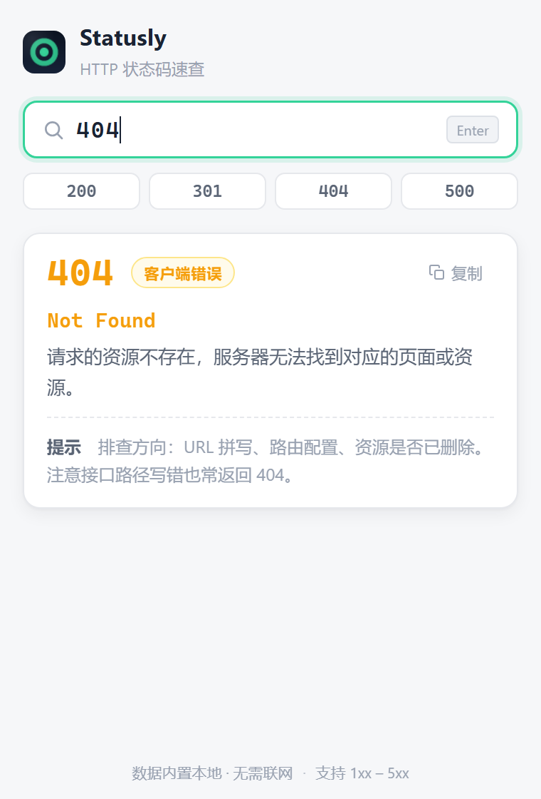

# Statusly — HTTP 状态码速查（Edge 扩展）

> 输入状态码，一秒看懂它是什么意思。极简、轻量、纯本地运行的 Microsoft Edge 浏览器扩展。

<p align="center">
  
</p>

## ✨ 功能特性

- **快速查询**：输入 `200`、`404`、`500` 等状态码，立即展示英文名称 + 中文解释 + 实用排查提示
- **支持回车查询**：敲下 Enter 即可，输入满 3 位数字还会自动查询
- **分类配色**：结果卡片按类别着色，一眼判断问题出在哪一层
  - 🟢 2xx 成功　🔵 3xx 重定向　🟠 4xx 客户端错误　🔴 5xx 服务器错误　🟣 1xx 信息响应
- **常用快捷码**：顶部内置 `200 / 301 / 404 / 500` 一键直达
- **一键复制**：点击「复制」按钮即可复制 `404 Not Found`
- **友好报错**：非数字、位数不对、范围超出、未收录的状态码都有清晰提示，并推荐相近状态码
- **深色模式**：自动跟随系统深浅色主题
- **零依赖**：纯 HTML / CSS / JavaScript，数据内置本地，**无需联网、无任何权限申请、不上传任何数据**

## 📦 安装到 Edge

因为这是一个开发版扩展，不需要从商店下载，直接以「开发者模式」加载即可，全程约 1 分钟：

### 第 1 步：下载代码

点击本仓库右上角绿色的 **Code** 按钮 → **Download ZIP**，下载后解压到一个**固定位置**（比如 `D:\statusly`，加载后不要移动或删除该文件夹）。

> 如果你会用 Git，也可以：`git clone https://github.com/Goblin-Master/statusly.git`

### 第 2 步：打开 Edge 扩展管理页

在 Edge 地址栏输入以下地址并回车：

```
edge://extensions
```

或者通过菜单进入：**右上角「…」→ 扩展 → 管理扩展**

### 第 3 步：开启开发者模式

在扩展管理页**左侧边栏**，打开 **「开发人员模式」** 开关。

### 第 4 步：加载扩展

点击页面上方的 **「加载解压缩的扩展」**，选择第 1 步解压出来的文件夹（里面有 `manifest.json` 的那一层），确认即可。

### 第 5 步：固定到工具栏，开始使用 🎉

点击 Edge 工具栏的拼图图标 🧩，找到 **Statusly** 并点击旁边的📌固定按钮。之后随时点击工具栏上的 Statusly 图标，输入状态码即可查询。

## 🕹️ 使用方法

| 操作 | 说明 |
| --- | --- |
| 输入状态码 + 回车 | 查询对应状态码的含义 |
| 输入满 3 位数字 | 自动查询，无需回车 |
| 点击顶部快捷码 | 一键查询 200 / 301 / 404 / 500 |
| 点击「复制」 | 复制状态码与英文名称，如 `404 Not Found` |
| 按 Esc | 清空输入，回到初始界面 |

## 📁 项目结构

```
statusly/
├── manifest.json       # Manifest V3 扩展配置
├── popup.html          # 弹窗页面结构
├── popup.css           # 弹窗样式（含深色模式）
├── popup.js            # 查询与交互逻辑
├── data/
│   └── codes.js        # 内置的 HTTP 状态码数据
├── icons/              # 扩展图标（16 / 32 / 48 / 128）
└── docs/               # 截图
```

## 🔧 本地开发与调试

1. 按上面的「安装到 Edge」加载扩展
2. 修改代码后，回到 `edge://extensions`，点击 Statusly 卡片上的 **「重新加载」** ↻ 按钮
3. 重新打开弹窗即可看到改动

**如何新增状态码**：编辑 `data/codes.js`，在对应分类下按格式追加一条即可：

```js
406: {
  name: "Not Acceptable",
  desc: "服务器无法生成符合 Accept 头要求的内容。",
  tip: "常见于客户端指定了 application/json 但服务端只能返回 XML。"
},
```

## ❓ 常见问题

**Q：点击扩展图标没有反应？**
确认 `edge://extensions` 中 Statusly 处于启用状态；如果刚修改过文件，先点「重新加载」。

**Q：为什么有的状态码查不到？**
扩展收录了 1xx–5xx 的常用与标准状态码，个别冷门码暂未收录，页面会给出相近的推荐。也欢迎提 PR 补充（见上节「如何新增状态码」）。

**Q：会收集我的数据吗？**
不会。扩展没有申请任何权限，不联网，所有查询都在本地完成。

**Q：Chrome 能用吗？**
可以。本项目使用标准 Manifest V3，在 Chrome 中通过 `chrome://extensions` 以相同方式加载即可。

## 📄 许可证

[MIT](LICENSE)
